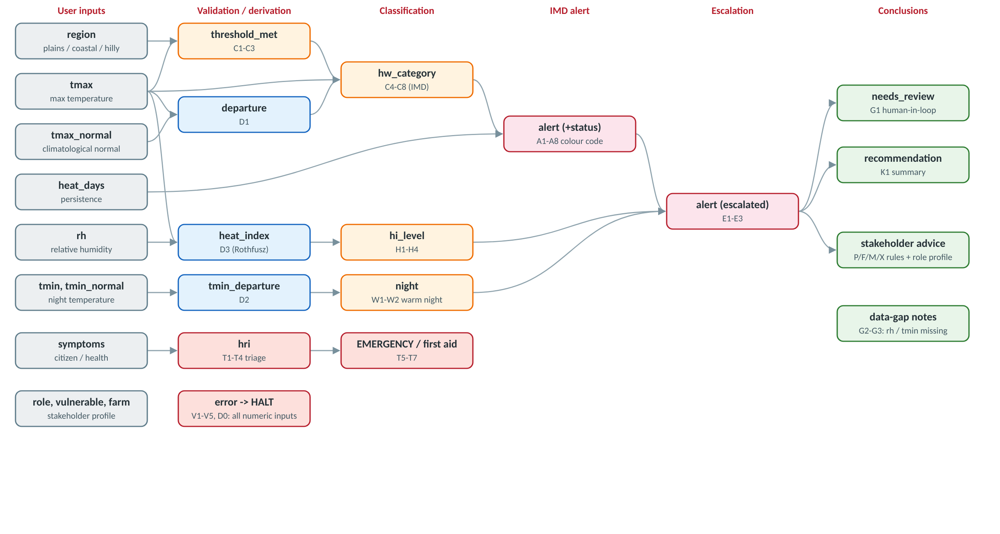

| | |
|---|---|
| **Institute** | Somaiya Vidyavihar University, K. J. Somaiya School of Engineering |
| **Department / Programme** | Electronics & Computer Engineering, CSBS, TY (Sem V), 2026-27 |
| **Course** | 216U50E514 Artificial Intelligence |
| **Faculty in-charge** | Dr. Ayesha Hakim |
| **SVU AI use case** | KJS-CES-01: Climate Intelligence for Heatwave Monitoring, Prediction, and Early Warning (faculty owner: Dr. Radhika Kotecha; collaborating organisation: IMD Mumbai-Pune) |
| **Group members** | 1. ____________ (Roll No. ______)  2. ____________ (Roll No. ______)  3. ____________ (Roll No. ______) |
| **Date of submission** | ___ / 10 / 2026 |

# D1. Problem Definition

## 1.1 Domain and motivation

Heatwaves are among the deadliest weather hazards in India. With climate change they are becoming more frequent, more intense and longer. The SVU use case **KJS-CES-01** sets out a five-phase heatwave intelligence platform: data acquisition, AI forecasting, IoT weather stations, forecast validation, and **Phase V: Advisory, Early Warning and Decision Support**. Phase V must "translate technical forecasts into stakeholder-specific advisories and early warnings for citizens, farmers, health agencies, and local authorities".

**HeatGuard** is a rule-based expert system for Phase V. It takes a temperature observation or forecast for a location, which in the full platform would come from IMD data, an AI forecast or an IoT Automated Weather Station. From that input it:

1. classifies the day using the **official IMD heat-wave criteria** (none / heat wave / severe heat wave);
2. assigns an **IMD colour-coded alert** (Green / Yellow / Orange / Red), taking persistence into account;
3. **escalates** the alert when nights are warm or humid heat is dangerous;
4. **triages heat-related illness symptoms** (heat stroke vs. heat exhaustion vs. heat cramps);
5. issues **advisories tailored to the stakeholder** (citizen, vulnerable person, outdoor worker, farmer, health department, municipal authority);
6. shows a full **explanation trace**: which rules fired, why, and on which guideline each rule is based.

## 1.2 Why a rule-based expert system?

Heat-wave declaration in India is *defined* by explicit, published thresholds. A heat wave is not a fuzzy pattern to be learned; it is a regulatory definition. Advisories (NDMA Do's & Don'ts, MoHFW first aid) are also explicit IF-THEN guidance. A rule-based system is therefore:

- **faithful**: it reproduces the official criteria exactly;
- **transparent and auditable**: the use case marks *Responsible AI* and *Human-in-the-loop* as **High** relevance, and every conclusion here can be traced to a rule and its source;
- **complementary to ML**: Phase II forecasts *what the temperature will be*; this system decides *what that temperature means and what people should do*. It can also check the facts in LLM-generated advisories (use-case governance item "ensuring factual consistency").

## 1.3 Scope

| In scope | Out of scope |
|---|---|
| IMD heat-wave & severe heat-wave classification for plains, coastal and hilly stations | Forecasting temperature (Phase II ML models) |
| IMD colour-coded alert from persistence (days) | Multi-station spatial aggregation (IMD needs ≥2 stations in a sub-division) |
| Warm-night and humid-heat (heat index) escalation | Real-time AWS ingestion (inputs are typed in or come from JSON) |
| First-level triage of heat-related illness symptoms | Medical diagnosis; the system only advises calling 108/112 |
| Advisories for 4 stakeholder roles and 5 vulnerable groups | Multilingual / LLM text generation |

## 1.4 Target users

- **Citizens and households**, including the elderly, infants, pregnant women, the chronically ill and outdoor workers.
- **Farmers** (crops and/or livestock).
- **Public health departments and hospitals** (preparedness and response).
- **Municipal corporations / District & State Disaster Management Authorities** (Heat Action Plan triggers).
- **Duty meteorologists**, who review Red alerts (human in the loop).

## 1.5 Sources of expert knowledge

The rules are taken from published guidelines, not invented:

- **S1** - IMD - Heat wave criteria (FAQ on Heat Wave, mausam.imd.gov.in): threshold 40 C plains / 37 C coastal / 30 C hilly; departure from normal 4.5-6.4 C = heat wave, >6.4 C = severe; actual Tmax >=45 C = heat wave, >=47 C = severe; declared when met on 2 consecutive days.
- **S2** - IMD - Colour-coded impact-based heat warnings (Green / Yellow / Orange / Red) based on intensity and persistence of heat wave days.
- **S3** - IMD - Warm night criteria: Tmax >=40 C and Tmin departure 4.5-6.4 C = warm night, >6.4 C = very warm night.
- **S4** - NDMA - Guidelines for Preparation of Action Plan: Prevention and Management of Heat Wave (2016, rev. 2019): Do's & Don'ts, stakeholder roles, cooling centres, work-hour rescheduling.
- **S5** - MoHFW / NCDC - National Programme on Climate Change & Human Health (NPCCHH): National Action Plan on Heat Related Illnesses (2021) - HRI symptoms, first aid, hospital preparedness.
- **S6** - US NWS / NOAA - Heat Index (Rothfusz regression, 1990) and risk bands: Caution 27-32 C, Extreme caution 32-39 C, Danger 39-51 C, Extreme danger >=51 C.
- **S7** - IMD / ICAR - Gramin Krishi Mausam Sewa agromet advisories for heat wave: irrigation timing, mulching, spraying, livestock care.
- **S8** - Ahmedabad Heat Action Plan (AMC, 2013 onward) - model city plan for alert-triggered actions by municipal and health departments.
- **S9** - SVU use case KJS-CES-01 - AI governance: human-in-the-loop review of critical warnings before dissemination.

# D2. Knowledge Base Design

## 2.1 Facts (working-memory attributes)

| Fact | Type / values | Origin |
|---|---|---|
| `role` | citizen, farmer, health, authority | user |
| `region` | plains, coastal, hilly | user |
| `tmax`, `tmax_normal` | °C | user (`tmax_normal` optional) |
| `heat_days` | 1-60 consecutive days | user (optional) |
| `rh` | 0-100 % | user (optional) |
| `tmin`, `tmin_normal` | °C | user (optional, asked only if Tmax ≥ 40) |
| `vulnerable` | elderly, infant_child, pregnant, chronic_illness, outdoor_worker | user (citizen) |
| `farm` | crops, livestock, both | user (farmer) |
| `symptoms` | 12 symptom codes | user (citizen / health) |
| `departure`, `tmin_departure`, `heat_index` | °C | derived (D1-D3) |
| `threshold_met`, `hw_category`, `night`, `hi_level`, `hri` | symbolic | inferred |
| `alert`, `status`, `escalated`, `needs_review`, `recommendation` | symbolic | inferred (conclusions) |

## 2.2 Rule layers and salience

The knowledge base holds **59 production rules** in 9 layers. Salience (priority) follows the order in which a duty officer would reason: life safety first, then data quality, then classification, then advice.

| Layer | Rules | Salience | Purpose |
|---|---|---|---|
| T - Triage | T1-T7 | 107-111 | Heat-illness triage; runs even if the weather data are invalid |
| V - Validation | V1-V5, D0 | 98-100 | Reject impossible inputs (HALT) |
| D - Derivation | D1-D3 | 90 | Departure from normal, Tmin departure, heat index |
| C/W/H - Classification | C1-C8, W1-W2, H1-H4 | 70-80 | IMD threshold & category, warm night, heat-stress band |
| A - Alert | A1-A8 | 55-62 | IMD colour code from category + persistence |
| E - Escalation | E1-E3 | 49-50 | Warm night / humid heat raises the alert one level |
| G - Governance | G1-G3 | 40 | Human review of Red alerts; notes on missing data |
| P/F/M/X - Advisory | 14 rules | 20 | Citizen, farmer, health-department, authority advice |
| K - Summary | K1 | 0 | Final recommendation |

## 2.3 Complete rule table (IF-THEN)

| ID | Rule | IF | THEN | Sal. | Src. |
|---|---|---|---|---|---|
| T1 | Heat stroke from neurological signs | symptoms contains_any ['confusion', 'unconscious', 'seizure'] | hri = 'heat_stroke' | 111 | S5 |
| T2 | Heat stroke from hot dry skin | symptoms contains 'high_body_temp' AND symptoms contains 'no_sweating' AND hri is unknown | hri = 'heat_stroke' | 110 | S5 |
| T3 | Heat exhaustion | hri is unknown AND symptoms contains_any ['heavy_sweating', 'dizziness', 'nausea', 'weakness', 'headache', 'fainting'] | hri = 'heat_exhaustion' | 109 | S5 |
| T4 | Heat cramps | hri is unknown AND symptoms contains 'muscle_cramps' | hri = 'heat_cramps' | 108 | S5 |
| T5 | Heat stroke emergency advice | hri == 'heat_stroke' | emergency = True; advise EMERGENCY | 107 | S5 |
| T6 | Heat exhaustion first aid | hri == 'heat_exhaustion' | advise FIRST AID | 107 | S5 |
| T7 | Heat cramps first aid | hri == 'heat_cramps' | advise FIRST AID | 107 | S5 |
| V1 | Implausible maximum temperature | tmax outside [-10, 55] | error = 'Tmax outside plausible range -10..55 C'; HALT | 100 | S1 |
| V2 | Implausible normal temperature | tmax_normal outside [5, 50] | error = 'Normal Tmax outside plausible range 5..50 C'; HALT | 100 | S1 |
| V3 | Invalid humidity | rh outside [0, 100] | error = 'Relative humidity must be 0..100 %'; HALT | 100 | S6 |
| V4 | Invalid persistence | heat_days outside [1, 60] | error = 'Consecutive hot days must be between 1 and 60'; HALT | 100 | S2 |
| D0 | Check Tmin against Tmax | tmin is known AND tmax is known | tmin_gt_tmax = <computed> | 99 | S3 |
| V5 | Tmin greater than Tmax | tmin_gt_tmax == True | error = 'Minimum temperature is higher than maximum temperature'; HALT | 98 | S3 |
| D1 | Compute Tmax departure from normal | tmax is known AND tmax_normal is known | departure = <computed> | 90 | S1 |
| D2 | Compute Tmin departure from normal | tmin is known AND tmin_normal is known | tmin_departure = <computed> | 90 | S3 |
| D3 | Compute heat index | tmax is known AND rh is known | heat_index = <computed> | 90 | S6 |
| C1 | Plains threshold reached | region == 'plains' AND tmax >= 40 | threshold_met = True | 80 | S1 |
| C2 | Coastal threshold reached | region == 'coastal' AND tmax >= 37 | threshold_met = True | 80 | S1 |
| C3 | Hilly threshold reached | region == 'hilly' AND tmax >= 30 | threshold_met = True | 80 | S1 |
| C4 | Severe heat wave by absolute temperature | threshold_met == True AND tmax >= 47 AND hw_category is unknown | hw_category = 'severe_heatwave' | 78 | S1 |
| C5 | Severe heat wave by departure | threshold_met == True AND departure > 6.4 AND hw_category is unknown | hw_category = 'severe_heatwave' | 78 | S1 |
| C6 | Heat wave by absolute temperature | threshold_met == True AND tmax >= 45 AND hw_category is unknown | hw_category = 'heatwave' | 76 | S1 |
| C7 | Heat wave by departure | threshold_met == True AND 4.5 <= departure <= 6.4 AND hw_category is unknown | hw_category = 'heatwave' | 76 | S1 |
| C8 | No heat wave (default) | tmax is known AND hw_category is unknown | hw_category = 'none' | 70 | S1 |
| W1 | Warm night | tmax >= 40 AND 4.5 <= tmin_departure <= 6.4 | night = 'warm_night' | 80 | S3 |
| W2 | Very warm night | tmax >= 40 AND tmin_departure > 6.4 | night = 'very_warm_night' | 80 | S3 |
| H1 | Heat index: caution | 27 <= heat_index < 32 | hi_level = 'caution' | 80 | S6 |
| H2 | Heat index: extreme caution | 32 <= heat_index < 39 | hi_level = 'extreme_caution' | 80 | S6 |
| H3 | Heat index: danger | 39 <= heat_index < 51 | hi_level = 'danger' | 80 | S6 |
| H4 | Heat index: extreme danger | heat_index >= 51 | hi_level = 'extreme_danger' | 80 | S6 |
| A1 | Green - no heat wave | hw_category == 'none' AND alert is unknown | alert = 'GREEN' | 60 | S2 |
| A2 | Heat wave on day 1 = watch | hw_category in ['heatwave', 'severe_heatwave'] AND heat_days == 1 AND alert is unknown | alert = 'YELLOW'; status = 'watch' | 62 | S1 |
| A3 | Heat wave persisting 2-3 days | hw_category == 'heatwave' AND 2 <= heat_days <= 3 AND alert is unknown | alert = 'YELLOW'; status = 'declared' | 60 | S2 |
| A4 | Heat wave persisting 4-6 days | hw_category == 'heatwave' AND 4 <= heat_days <= 6 AND alert is unknown | alert = 'ORANGE'; status = 'declared' | 60 | S2 |
| A5 | Heat wave persisting > 6 days | hw_category == 'heatwave' AND heat_days > 6 AND alert is unknown | alert = 'RED'; status = 'declared' | 60 | S2 |
| A6 | Severe heat wave for 2 days | hw_category == 'severe_heatwave' AND heat_days == 2 AND alert is unknown | alert = 'ORANGE'; status = 'declared' | 60 | S2 |
| A7 | Severe heat wave for > 2 days | hw_category == 'severe_heatwave' AND heat_days > 2 AND alert is unknown | alert = 'RED'; status = 'declared' | 60 | S2 |
| A8 | Alert when duration not given | hw_category in ['heatwave', 'severe_heatwave'] AND heat_days is unknown AND alert is unknown | alert = 'YELLOW'; status = 'watch' | 55 | S2 |
| E1 | Warm night escalates Yellow to Orange | night in ['warm_night', 'very_warm_night'] AND alert == 'YELLOW' | alert = 'ORANGE'; escalated = 'warm night' | 50 | S3 |
| E2 | Humid heat on a non-heatwave day | alert == 'GREEN' AND hi_level in ['danger', 'extreme_danger'] | alert = 'YELLOW'; escalated = 'humid heat stress' | 50 | S6 |
| E3 | Extreme heat index escalates Yellow | alert == 'YELLOW' AND hi_level == 'extreme_danger' AND rh >= 40 AND escalated is unknown | alert = 'ORANGE'; escalated = 'extreme humid heat' | 49 | S6 |
| G1 | Red alert needs human validation | alert == 'RED' | needs_review = True; advise GOVERNANCE | 40 | S9 |
| G2 | Humidity missing | rh is unknown AND tmax is known | advise NOTE | 40 | S6 |
| G3 | Night temperature missing | tmin is unknown AND tmax >= 40 | advise NOTE | 40 | S3 |
| P1 | Citizen - normal day | role == 'citizen' AND alert == 'GREEN' | advise CITIZEN | 20 | S4 |
| P2 | Citizen - basic heat precautions | role == 'citizen' AND alert in ['YELLOW', 'ORANGE', 'RED'] | advise CITIZEN | 20 | S4 |
| P3 | Citizen - severe alert precautions | role == 'citizen' AND alert in ['ORANGE', 'RED'] | advise CITIZEN | 20 | S4 |
| P4 | Citizen - vulnerable person at home | role == 'citizen' AND alert in ['YELLOW', 'ORANGE', 'RED'] AND vulnerable contains_any ['elderly', 'infant_child', 'pregnant', 'chronic_illness'] | advise VULNERABLE | 20 | S5 |
| P5 | Citizen - outdoor worker | role == 'citizen' AND alert in ['YELLOW', 'ORANGE', 'RED'] AND vulnerable contains 'outdoor_worker' | advise WORKER | 20 | S4 |
| F1 | Farmer - normal day | role == 'farmer' AND alert == 'GREEN' | advise FARMER | 20 | S7 |
| F2 | Farmer - crop protection | role == 'farmer' AND alert in ['YELLOW', 'ORANGE', 'RED'] AND farm in ['crops', 'both'] | advise FARMER | 20 | S7 |
| F3 | Farmer - livestock protection | role == 'farmer' AND alert in ['YELLOW', 'ORANGE', 'RED'] AND farm in ['livestock', 'both'] | advise FARMER | 20 | S7 |
| M1 | Health dept - alert preparedness | role == 'health' AND alert == 'YELLOW' | advise HEALTH | 20 | S5 |
| M2 | Health dept - severe alert response | role == 'health' AND alert in ['ORANGE', 'RED'] | advise HEALTH | 20 | S5 |
| M3 | Health dept - normal day | role == 'health' AND alert == 'GREEN' | advise HEALTH | 20 | S5 |
| X1 | Authority - heat alert actions | role == 'authority' AND alert == 'YELLOW' | advise AUTHORITY | 20 | S8 |
| X2 | Authority - severe alert actions | role == 'authority' AND alert in ['ORANGE', 'RED'] | advise AUTHORITY | 20 | S4 |
| X3 | Authority - normal day | role == 'authority' AND alert == 'GREEN' | advise AUTHORITY | 20 | S8 |
| K1 | Compose final recommendation | alert is known | recommendation = <computed> | 0 | S2 |

## 2.4 Rule-dependency diagram



## 2.5 Design decisions for consistency and non-redundancy

- **Mutually exclusive categories.** C4-C7 all require `hw_category is unknown`. With severe rules at higher salience (78) than heat-wave rules (76), the first category concluded is the final one, so no two category rules contradict each other.
- **Single default.** C8 (*no heat wave*) has the lowest classification salience (70). It fires only when no criterion matched. This is the expert-system form of "otherwise".
- **Escalation by one level only.** E3 requires `escalated is unknown`, so warm night plus humid heat cannot push Yellow to Red. The use case asks the system to communicate uncertainty, not to over-warn.
- **Edge cases covered.** Exact thresholds (40.0 °C, +4.5 °C) and just-below values (39.9 °C) are tested. So are missing optional inputs, impossible values, physically inconsistent values (Tmin > Tmax), and dangerous humid heat below the IMD thresholds (Mumbai).

# D3. Implementation

## 3.1 Architecture

```
heatwave_es/
  engine.py          generic forward-chaining engine (working memory, agenda,
                     conflict resolution, trace, HOW explanation)
  knowledge_base.py  the rules + sources + heat-index computation (domain only)
  explain.py         recommendation / advisory / trace / HOW formatting
  cli.py             interactive question-answer interface (WHY, skip, HOW)
  scenarios.py       test scenarios (D4)
server.py            JSON API + host for the React UI (stdlib only)
frontend/            HeatGuard Atlas React UI (Vite, Tailwind, React Bits)
app.py               Streamlit web interface (optional)
prolog/heatguard.pl  SWI-Prolog edition: backward chaining meta-interpreter
tests/               pytest suite
```

The **knowledge base is kept separate from the inference engine**. The rules are data (`Rule` objects with conditions, actions, salience and source), so a domain expert could add a rule without touching the engine.

## 3.2 Choice of inference strategy: forward chaining (justified)

The Python engine uses **forward chaining** (data-driven), for these reasons:

1. **The data arrive first.** In the use-case pipeline, observations and forecasts (IMD grids, AWS readings, ML forecasts) are pushed to the advisory module. The natural question is "given these readings, what follows?", which is a forward-chaining question.
2. **There are many conclusions, not one goal.** From one observation the system must derive the category, the alert, escalations, governance flags *and* advice for several audiences. Backward chaining would need a separate query for each goal.
3. **Monitoring suits it.** In deployment the same rules re-run every time an AWS reading arrives. Forward chaining is the standard architecture for monitoring and alerting systems (as in CLIPS and OPS5).
4. **Priority matters.** Salience-based conflict resolution lets *life-safety triage* fire before everything else and *validation* halt bad data before any classification.

For comparison, the **Prolog edition uses backward chaining**. It starts from the goal `final_alert(L)` and asks the user *only* for facts that the current line of proof needs. For example, it never asks for the normal temperature when Tmax is below the regional threshold. This is ideal for an interactive consultation, and the viva discussion compares the two.

## 3.3 The recognise-act cycle and conflict resolution

```
repeat
    MATCH   : agenda = all rules whose conditions hold and that have not fired
    if agenda empty: stop
    RESOLVE : pick 1 rule by (1) refraction, (2) highest salience,
              (3) highest specificity (most conditions), (4) rule order
    ACT     : assert/modify facts, emit advice, record trace; HALT if rule says so
```

- **Refraction**: each rule fires at most once, which guarantees termination.
- **Salience**: domain priority, e.g. T1 (heat stroke, 111) before V1 (validation, 100).
- **Specificity**: a more specific rule beats a general one at equal salience.
- **Robustness**: conditions on missing facts are simply not satisfied, so the engine never crashes on missing input. Implausible values trigger validation rules that HALT with a clear message. A type error inside an action (e.g. text where a number is expected) is caught and reported as an input error.

## 3.4 Explanation facility

- **Trace**: for every fired rule, the system shows its id, name, salience and source, each condition with the *actual* value matched, the facts asserted, a one-line justification ("WHY"), and the other rules that were in the conflict set at that moment.
- **HOW**: a recursive proof tree for any concluded fact (e.g. `how alert`). It correctly shows an escalated alert as derived from the earlier alert value.
- **WHY (during questioning)**: typing `why` at any question explains why it is asked and lists the rules that use the answer.
- **Sources**: every report ends with the guidelines used for that run.

## 3.5 User interface

- **CLI** (`python -m heatwave_es`): asks only relevant questions (role-dependent, and Tmin only when Tmax ≥ 40 °C). It accepts prefixes (`p` → plains), validates ranges, lets optional questions be skipped, re-asks politely on bad input, and supports `why`, `how <fact>`, `new` and `quit`.
- **Batch mode** (`python -m heatwave_es --json case.json`) and **rule listing** (`--rules`).
- **HeatGuard Atlas web UI** (`python server.py`, then open http://localhost:8000): a React + Tailwind single-page app built with React Bits components. It has an Aurora hero, a four-step Stepper consultation, the live verdict with a decrypting alert level, SpotlightCards, AnimatedList advisories and rule-firing trace, an interactive HOW proof tree, and a searchable knowledge base that highlights the rules that fired. The Python standard-library server (`server.py`) exposes the engine as a JSON API (`/api/consult`, `/api/kb`, `/api/scenarios`), so the UI and the CLI share exactly the same inference engine.
- **Streamlit UI** (`streamlit run app.py`): a lighter alternative interface.
- **Prolog** (`swipl prolog/heatguard.pl`, then `?- start.`): goal-driven consultation with `why` and a proof tree.

## 3.6 Sample run (TC09, warm-night escalation)

```
========================================================================
RECOMMENDATION
========================================================================
ORANGE ALERT (Severe heat alert - be prepared) - IMD category: heatwave
  - Tmax departure from normal: +5.8 C
  - Heat index (feels like): 51.7 C - extreme danger
  - Night: warm night
  - Alert escalated because of: warm night

ADVISORY
------------------------------------------------------------------------
[CITIZEN]
  * Avoid going out in the sun, especially 12:00-15:00.  (P2)
  * Drink water often even if not thirsty; use ORS, lassi, buttermilk, lemon water, aam panna.  (P2)
  * Wear light, loose, light-coloured cotton clothes; cover head with cap/umbrella/cloth.  (P2)
  * Avoid strenuous activity outdoors; stay in the coolest room, keep curtains/shades closed by day, open windows at night.  (P3)
  * Never leave children or pets in parked vehicles.  (P3)
  * Avoid alcohol, tea, coffee, carbonated drinks and heavy high-protein meals.  (P3)
[VULNERABLE]
  * Check on elderly, infants, pregnant women and people with heart/kidney disease or diabetes at least twice a day.  (P4)
  * Keep medicines below 25 C; consult doctor about diuretics / fluid limits before increasing water intake.  (P4)
[WORKER]
  * Shift heavy outdoor work to early morning / evening; rest in shade frequently and drink a cup of cool water every 15-20 min.  (P5)
  * Newly returned or new workers: build up exposure gradually over a week (acclimatisation).  (P5)

EXPLANATION TRACE (15 rules fired)
------------------------------------------------------------------------
 1. D0  Check Tmin against Tmax   [salience 99, source S3]
 2. D1  Compute Tmax departure from normal   [salience 90, source S1]
 3. D2  Compute Tmin departure from normal   [salience 90, source S3]
 4. D3  Compute heat index   [salience 90, source S6]
 5. C1  Plains threshold reached   [salience 80, source S1]
 6. W1  Warm night   [salience 80, source S3]
 7. H4  Heat index: extreme danger   [salience 80, source S6]
 8. C6  Heat wave by absolute temperature   [salience 76, source S1]
 9. A3  Heat wave persisting 2-3 days   [salience 60, source S2]
10. E1  Warm night escalates Yellow to Orange   [salience 50, source S3]
11. P4  Citizen - vulnerable person at home   [salience 20, source S5]
12. P5  Citizen - outdoor worker   [salience 20, source S4]
13. P2  Citizen - basic heat precautions   [salience 20, source S4]
14. P3  Citizen - severe alert precautions   [salience 20, source S4]
15. K1  Compose final recommendation   [salience 0, source S2]

HOW WAS THE ALERT LEVEL CONCLUDED?
------------------------------------------------------------------------
alert = ORANGE  <- E1 'Warm night escalates Yellow to Orange'
  night = warm_night  <- W1 'Warm night'
    tmax = 45.6  (given by user)
    tmin_departure = 5.0  <- D2 'Compute Tmin departure from normal'
      tmin = 31.0  (given by user)
      tmin_normal = 26.0  (given by user)
  alert = YELLOW  <- A3 'Heat wave persisting 2-3 days'
    hw_category = heatwave  <- C6 'Heat wave by absolute temperature'
      threshold_met = True  <- C1 'Plains threshold reached'
        region = plains  (given by user)
        tmax = 45.6  (given by user)
      tmax = 45.6  (given by user)
    heat_days = 3  (given by user)

KNOWLEDGE SOURCES USED
------------------------------------------------------------------------
S1: IMD - Heat wave criteria (FAQ on Heat Wave, mausam.imd.gov.in): threshold 40 C plains / 37 C coastal / 30 C hilly; departure from normal 4.5-6.4 C = heat wave, >6.4 C = severe; actual Tmax >=45 C = heat wave, >=47 C = severe; declared when met on 2 consecutive days.
S2: IMD - Colour-coded impact-based heat warnings (Green / Yellow / Orange / Red) based on intensity and persistence of heat wave days.
S3: IMD - Warm night criteria: Tmax >=40 C and Tmin departure 4.5-6.4 C = warm night, >6.4 C = very warm night.
S4: NDMA - Guidelines for Preparation of Action Plan: Prevention and Management of Heat Wave (2016, rev. 2019): Do's & Don'ts, stakeholder roles, cooling centres, work-hour rescheduling.
S5: MoHFW / NCDC - National Programme on Climate Change & Human Health (NPCCHH): National Action Plan on Heat Related Illnesses (2021) - HRI symptoms, first aid, hospital preparedness.
S6: US NWS / NOAA - Heat Index (Rothfusz regression, 1990) and risk bands: Caution 27-32 C, Extreme caution 32-39 C, Danger 39-51 C, Extreme danger >=51 C.
========================================================================
```

# D4. Test Case Report

The automated suite (`python -m pytest`) runs **15 scenarios** plus unit tests for the web API, conflict resolution, the HOW explanation, the heat-index reference values and wrong-type input. Each scenario asserts the expected conclusions, the rules that must fire and the rules that must *not* fire.

**Result: 25 passed in 0.06s**

## 4.1 Summary

| TC | Scenario | Alert / outcome | Rules fired | Result |
|---|---|---|---|---|
| TC01 | Normal summer day, Pune (plains) - no heat wave | GREEN / none | 7 | PASS |
| TC02 | Humid heat, Mumbai (coastal) - below IMD threshold | YELLOW / none | 9 | PASS |
| TC03 | Severe heat wave for 4 days, Vidarbha (farmer) | RED / severe_heatwave | 11 | PASS |
| TC04 | Heat wave criteria met on day 1 only (municipal authority) | YELLOW / heatwave | 9 | PASS |
| TC05 | Hill station (Mahabaleshwar) severe departure, 2 days (health dept) | ORANGE / severe_heatwave | 8 | PASS |
| TC06 | Heat stroke symptoms during heat wave (emergency) | YELLOW / heatwave + EMERGENCY | 12 | PASS |
| TC07 | Invalid sensor reading (Tmax = 62 C) - graceful halt | ERROR (halt V1) | 1 | PASS |
| TC08 | Missing optional data (no normal, no duration, no humidity) | YELLOW / heatwave | 7 | PASS |
| TC09 | Warm night escalates Yellow to Orange (vulnerable household) | ORANGE / heatwave | 15 | PASS |
| TC10 | Inconsistent data: Tmin higher than Tmax | ERROR (halt V5) | 2 | PASS |
| TC11 | Boundary: Tmax exactly 40.0 C, departure exactly 4.5 C | YELLOW / heatwave | 9 | PASS |
| TC12 | Boundary: 39.9 C in plains with +5 C departure - threshold not met | GREEN / none | 7 | PASS |
| TC13 | Prolonged heat wave (7 days) - Red with human review | RED / heatwave | 12 | PASS |
| TC14 | Coastal heat wave with very warm night (Ratnagiri) | ORANGE / heatwave | 14 | PASS |
| TC15 | Heat wave day 2 with extreme humid heat index (Konkan coast) | ORANGE / heatwave | 9 | PASS |

## 4.2 Detailed scenarios

**TC01: Normal summer day, Pune (plains) - no heat wave**

- *Inputs:* `role=citizen, region=plains, tmax=34.0, tmax_normal=33.0, heat_days=1, rh=30`
- *Expected:* alert = GREEN, hw_category = none
- *Rules fired (in order):* D1 → D3 → H2 → C8 → A1 → P1 → K1
- *Output:* GREEN ALERT (No action - normal day); advice for: CITIZEN
- *Result:* **PASS**

**TC02: Humid heat, Mumbai (coastal) - below IMD threshold**

- *Inputs:* `role=citizen, region=coastal, tmax=35.0, tmax_normal=33.0, heat_days=2, rh=60, vulnerable=elderly`
- *Expected:* alert = YELLOW, hw_category = none, hi_level = danger, escalated = humid heat stress
- *Rules fired (in order):* D1 → D3 → H3 → C8 → A1 → E2 → P4 → P2 → K1
- *Output:* YELLOW ALERT (Heat alert - be updated); advice for: CITIZEN, VULNERABLE
- *Result:* **PASS**

**TC03: Severe heat wave for 4 days, Vidarbha (farmer)**

- *Inputs:* `role=farmer, region=plains, tmax=47.2, tmax_normal=42.0, heat_days=4, rh=18, farm=both`
- *Expected:* alert = RED, hw_category = severe_heatwave, needs_review = True
- *Rules fired (in order):* D1 → D3 → C1 → H3 → C4 → A7 → G3 → G1 → F2 → F3 → K1
- *Output:* RED ALERT (Extreme heat alert - take action) - IMD category: severe heatwave; advice for: FARMER, GOVERNANCE, NOTE
- *Result:* **PASS**

**TC04: Heat wave criteria met on day 1 only (municipal authority)**

- *Inputs:* `role=authority, region=plains, tmax=44.0, tmax_normal=39.0, heat_days=1, rh=20`
- *Expected:* alert = YELLOW, hw_category = heatwave, status = watch
- *Rules fired (in order):* D1 → D3 → C1 → H3 → C7 → A2 → G3 → X1 → K1
- *Output:* YELLOW ALERT (Heat alert - be updated) - IMD category: heatwave [WATCH: not yet declared, needs 2nd consecutive day]; advice for: AUTHORITY, NOTE
- *Result:* **PASS**

**TC05: Hill station (Mahabaleshwar) severe departure, 2 days (health dept)**

- *Inputs:* `role=health, region=hilly, tmax=31.5, tmax_normal=24.5, heat_days=2, rh=40`
- *Expected:* alert = ORANGE, hw_category = severe_heatwave
- *Rules fired (in order):* D1 → D3 → C3 → H1 → C5 → A6 → M2 → K1
- *Output:* ORANGE ALERT (Severe heat alert - be prepared) - IMD category: severe heatwave; advice for: HEALTH
- *Result:* **PASS**

**TC06: Heat stroke symptoms during heat wave (emergency)**

- *Inputs:* `role=citizen, region=plains, tmax=45.0, tmax_normal=40.0, heat_days=2, rh=22, vulnerable=elderly, symptoms=high_body_temp/confusion/no_sweating`
- *Expected:* alert = YELLOW, hri = heat_stroke, emergency = True
- *Rules fired (in order):* T1 → T5 → D1 → D3 → C1 → H3 → C6 → A3 → G3 → P4 → P2 → K1
- *Output:* YELLOW ALERT (Heat alert - be updated) - IMD category: heatwave; advice for: CITIZEN, EMERGENCY, NOTE, VULNERABLE
- *Result:* **PASS**

**TC07: Invalid sensor reading (Tmax = 62 C) - graceful halt**

- *Inputs:* `role=citizen, region=plains, tmax=62.0, tmax_normal=40.0, heat_days=2`
- *Expected:* error = Tmax outside plausible range -10..55 C
- *Rules fired (in order):* V1
- *Output:* INPUT ERROR: Tmax outside plausible range -10..55 C
- *Result:* **PASS**

**TC08: Missing optional data (no normal, no duration, no humidity)**

- *Inputs:* `role=citizen, region=plains, tmax=46.0`
- *Expected:* alert = YELLOW, hw_category = heatwave, status = watch
- *Rules fired (in order):* C1 → C6 → A8 → G2 → G3 → P2 → K1
- *Output:* YELLOW ALERT (Heat alert - be updated) - IMD category: heatwave [WATCH: not yet declared, needs 2nd consecutive day]; advice for: CITIZEN, NOTE
- *Result:* **PASS**

**TC09: Warm night escalates Yellow to Orange (vulnerable household)**

- *Inputs:* `role=citizen, region=plains, tmax=45.6, tmax_normal=39.8, heat_days=3, rh=25, tmin=31.0, tmin_normal=26.0, vulnerable=elderly/outdoor_worker`
- *Expected:* alert = ORANGE, night = warm_night, escalated = warm night
- *Rules fired (in order):* D0 → D1 → D2 → D3 → C1 → W1 → H4 → C6 → A3 → E1 → P4 → P5 → P2 → P3 → K1
- *Output:* ORANGE ALERT (Severe heat alert - be prepared) - IMD category: heatwave; advice for: CITIZEN, VULNERABLE, WORKER
- *Result:* **PASS**

**TC10: Inconsistent data: Tmin higher than Tmax**

- *Inputs:* `role=citizen, region=plains, tmax=41.0, tmax_normal=38.0, tmin=43.0, tmin_normal=27.0`
- *Expected:* error = Minimum temperature is higher than maximum temperature
- *Rules fired (in order):* D0 → V5
- *Output:* INPUT ERROR: Minimum temperature is higher than maximum temperature
- *Result:* **PASS**

**TC11: Boundary: Tmax exactly 40.0 C, departure exactly 4.5 C**

- *Inputs:* `role=authority, region=plains, tmax=40.0, tmax_normal=35.5, heat_days=2, rh=15`
- *Expected:* alert = YELLOW, hw_category = heatwave
- *Rules fired (in order):* D1 → D3 → C1 → H2 → C7 → A3 → G3 → X1 → K1
- *Output:* YELLOW ALERT (Heat alert - be updated) - IMD category: heatwave; advice for: AUTHORITY, NOTE
- *Result:* **PASS**

**TC12: Boundary: 39.9 C in plains with +5 C departure - threshold not met**

- *Inputs:* `role=authority, region=plains, tmax=39.9, tmax_normal=34.9, heat_days=3, rh=15`
- *Expected:* alert = GREEN, hw_category = none
- *Rules fired (in order):* D1 → D3 → H2 → C8 → A1 → X3 → K1
- *Output:* GREEN ALERT (No action - normal day); advice for: AUTHORITY
- *Result:* **PASS**

**TC13: Prolonged heat wave (7 days) - Red with human review**

- *Inputs:* `role=health, region=plains, tmax=45.5, tmax_normal=41.5, heat_days=7, rh=20, symptoms=muscle_cramps`
- *Expected:* alert = RED, hw_category = heatwave, hri = heat_cramps, needs_review = True
- *Rules fired (in order):* T4 → T7 → D1 → D3 → C1 → H3 → C6 → A5 → G3 → G1 → M2 → K1
- *Output:* RED ALERT (Extreme heat alert - take action) - IMD category: heatwave; advice for: FIRST AID, GOVERNANCE, HEALTH, NOTE
- *Result:* **PASS**

**TC14: Coastal heat wave with very warm night (Ratnagiri)**

- *Inputs:* `role=citizen, region=coastal, tmax=40.0, tmax_normal=34.0, heat_days=2, rh=55, tmin=32.0, tmin_normal=25.0, vulnerable=infant_child`
- *Expected:* alert = ORANGE, hw_category = heatwave, night = very_warm_night
- *Rules fired (in order):* D0 → D1 → D2 → D3 → C2 → W2 → H4 → C7 → A3 → E1 → P4 → P2 → P3 → K1
- *Output:* ORANGE ALERT (Severe heat alert - be prepared) - IMD category: heatwave; advice for: CITIZEN, VULNERABLE
- *Result:* **PASS**

**TC15: Heat wave day 2 with extreme humid heat index (Konkan coast)**

- *Inputs:* `role=authority, region=coastal, tmax=38.5, tmax_normal=33.5, heat_days=2, rh=65`
- *Expected:* alert = ORANGE, hw_category = heatwave, hi_level = extreme_danger, escalated = extreme humid heat
- *Rules fired (in order):* D1 → D3 → C2 → H4 → C7 → A3 → E3 → X2 → K1
- *Output:* ORANGE ALERT (Severe heat alert - be prepared) - IMD category: heatwave; advice for: AUTHORITY
- *Result:* **PASS**


## 4.3 Cross-check with the Prolog edition

Scenarios TC01, TC02, TC03, TC04, TC06 and TC09 were also run through the backward-chaining Prolog edition (`?- run_tests_cases.`). It produced **the same alert levels** (Green, Yellow, Red, Yellow-watch, Yellow + emergency, Orange), which shows that the knowledge is independent of the inference strategy.

# D5. Demo Plan (live run, 2-3 queries)

1. **Normal vs. watch vs. declared**: TC01 (Green) → TC04 (Yellow *watch*, day 1) → change days to 3 (Yellow *declared*). Shows the IMD persistence rule.
2. **Escalation and HOW**: TC09. Show the trace, then type `how alert` to see Yellow (A3) → Orange (E1, warm night).
3. **Robustness and life safety**: enter Tmax = 62 (V1 halts with a clear message), then TC06 (heat-stroke symptoms → EMERGENCY advice fires first).
4. *(Optional)* The same consultation in Prolog: type `why` at the "normal temperature" question to show the goal stack.

# D6. Reflection Notes (individual, ½ page each)

*Each member writes this section separately in their own words. The prompts below are a guide.*

**Member 1, ____________ (Roll No. ______)**
*Contribution:* ______________________________________________
*One limitation of rule-based systems observed:* ______________________________________________

**Member 2, ____________ (Roll No. ______)**
*Contribution:* ______________________________________________
*One limitation of rule-based systems observed:* ______________________________________________

**Member 3, ____________ (Roll No. ______)**
*Contribution:* ______________________________________________
*One limitation of rule-based systems observed:* ______________________________________________

Limitations we observed, for members to choose from and expand:

- **Brittle crisp thresholds.** 39.9 °C gives *Green* and 40.0 °C gives *Yellow* (TC11 vs. TC12). Real risk is continuous, and fuzzy logic or certainty factors would model it better.
- **The knowledge-acquisition bottleneck.** IMD defines the colour code in words ("persists for more than 2 days"), and turning these into rules forced us to make choices. Day-1 severe heat had to become a *watch*, and the case where the duration is unknown needed its own rule (A8).
- **Rule interaction is hard to reason about.** Our first version escalated hot, dry 44 °C days to Orange, because the Rothfusz heat-index formula exaggerates heat stress in very dry air. Adding the RH ≥ 40 % condition to E3 fixed it, but the bug appeared only through testing.
- **No learning.** The system cannot adapt to local mortality data, so new evidence means a manual rule edit.
- **No uncertainty handling.** A forecast of 45 °C with 60 % confidence is treated the same as an observed 45 °C.
- **Scalability.** Validating 59 rules was manageable, but with hundreds of rules, conflicts and redundancy become hard to spot without tools.

# References

1. India Meteorological Department (IMD). *FAQ on Heat Wave* and heat-wave criteria; colour-coded impact-based warnings. https://mausam.imd.gov.in
2. IMD. Warm night criteria, Climate Services, IMD Pune. https://imdpune.gov.in
3. National Disaster Management Authority (NDMA). *Guidelines for Preparation of Action Plan - Prevention and Management of Heat Wave*, 2016 (revised 2019). https://ndma.gov.in
4. Ministry of Health & Family Welfare, NCDC. *National Action Plan on Heat Related Illnesses*, National Programme on Climate Change and Human Health (NPCCHH), 2021.
5. Rothfusz, L. P. (1990). *The Heat Index Equation*. NWS Southern Region Technical Attachment SR 90-23; NOAA WPC heat-index equation page.
6. IMD / ICAR. Gramin Krishi Mausam Sewa - district agromet advisories for heat wave (crop and livestock management).
7. Knowlton, K. et al. (2014). Development and implementation of South Asia's first heat-health action plan in Ahmedabad (India). *Int. J. Environ. Res. Public Health*, 11(4), 3473-3492.
8. Somaiya Vidyavihar University. AI Use Case KJS-CES-01: *Climate Intelligence for Heatwave Monitoring, Prediction, and Early Warning* (Dr. Radhika Kotecha).
9. Giarratano, J. & Riley, G. *Expert Systems: Principles and Programming*, 4th ed., Thomson (forward chaining, Rete, conflict resolution, CLIPS).
10. Russell, S. & Norvig, P. *Artificial Intelligence: A Modern Approach*, 4th ed. - Ch. 9, inference in first-order logic (forward/backward chaining).
